# 09 使用手册 —— ACM-Trainer

> 面向使用者的操作手册（**v1.10.0**）。全部配图由真实应用自动截图生成（`npm run docs:shots`，共 **24 张**）。
> 规范/设计文档见 `docs/00–08`，STL 速查同源文档见 `docs/10-STL参考.md`；验收清单见 `docs/06`。

## 目录

1. [安装与启动](#1-安装与启动)
2. [界面总览](#2-界面总览)
3. [首次使用：同步题库](#3-首次使用同步题库)
   - [3.1 力扣（LeetCode）题库同步](#31-力扣leetcode题库同步)
4. [题库：筛选与知识点筛选](#4-题库筛选与知识点筛选)
   - [4.1.1 排序说明](#411-排序说明v191-修订)
   - [4.2 知识点筛选](#42-知识点筛选按技能树知识点练题)
5. [题面：用 Edge 浏览器打开](#5-题面用-edge-浏览器打开)
6. [记录练习](#6-记录练习)
7. [学习路径（技能树）](#7-学习路径技能树)
   - [7.1 单知识点 / 批量去题库练习](#单个知识点--去题库练习v191)
   - [7.2 国内比赛赛道（v1.10）](#国内比赛赛道v110fr-26)
8. [STL 速查（参考资料）](#85-stl-速查参考资料)
9. [统计](#8-统计)
   - [8.1 难度分布（按题源）](#81-难度分布按题源)
10. [笔记与错题本](#9-笔记与错题本)
11. [模板库](#10-模板库)
12. [虚拟比赛](#11-虚拟比赛)
13. [水平评估](#12-水平评估)
    - [12.1 力扣练习水平](#121-力扣练习水平)
14. [设置](#13-设置)
    - [13.1 力扣难度映射](#131-力扣难度映射)
15. [洛谷 UID 做题记录导入](#14-洛谷-uid-做题记录导入)
16. [数据备份与迁移](#15-数据备份与迁移)
17. [常见问题（FAQ）](#16-常见问题faq)
18. [快捷键与小技巧](#17-快捷键与小技巧)
19. [**题单**（v1.10，FR-27）](#18-题单v110fr-27)
    - [18.1 题库勾选加入](#181-建法一从题库勾选加入)
    - [18.2 粘贴题号识别](#182-建法二粘贴题号文本识别)
    - [18.3 按知识点 + 难度一键生成](#183-建法三按知识点--难度一键生成)
20. [**题单内复习与「今日复习」**（v1.10，FR-29）](#19-题单内复习与今日复习v110fr-29)
21. [**训练计划**（v1.10，日历排期式，FR-28）](#20-训练计划v110日历排期式fr-28)

---

## 1. 安装与启动

### 方式一：安装包（推荐，无需 Node 环境）

1. 运行 `dist\ACM-Trainer-1.10.1-setup.exe`（约 90MB，Windows 10/11 x64；v1.9.1 及更早请使用对应版本的安装包）；
2. 可选安装目录、自动创建桌面快捷方式；
3. 双击桌面 **ACM-Trainer** 启动。

免安装版：解压 `dist\win-unpacked\`，直接运行其中的 `ACM-Trainer.exe`。

### 方式二：源码运行（开发/调试）

```bat
cd C:\Workspace\acm-trainer
install.bat          :: 首次：安装依赖（需 Node.js ≥ 20）
start-dev.bat        :: 启动应用
```

### 数据位置

| 内容 | 路径 |
| ---- | ---- |
| 数据库（题库/记录/笔记/模板/比赛/评估） | `%APPDATA%\acm-trainer\acm-trainer.db` |
| 崩溃日志（启动失败时查看） | `%APPDATA%\acm-trainer\crash.log` |
| 头像文件 | `%APPDATA%\acm-trainer\avatar.*` |

> 迁移到新电脑：复制 `acm-trainer.db` 到同样路径即可；或用「设置 → 数据备份」导出/导入 JSON。

---

## 2. 界面总览

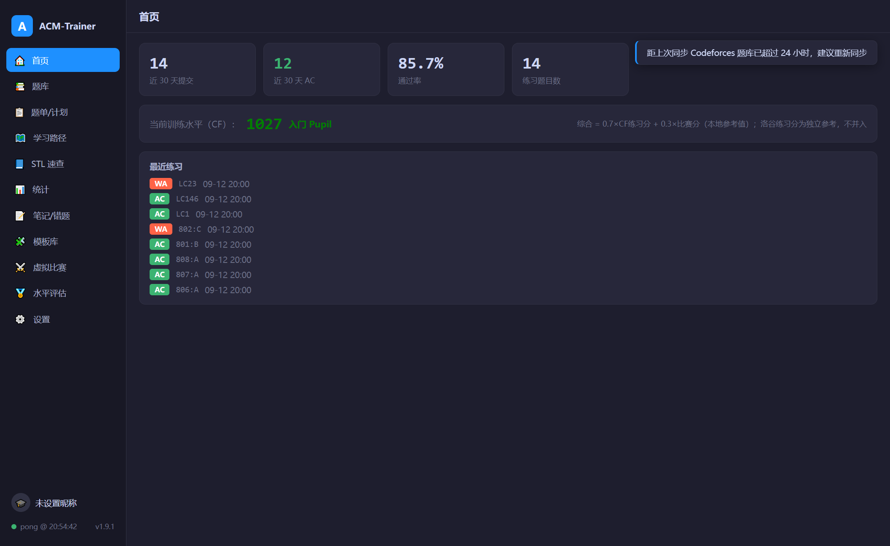

- **左侧边栏（11 项）**：首页 / 题库 / **📋 题单·计划** / 学习路径 / STL 速查 / 统计 / 笔记·错题 / 模板库 / 虚拟比赛 / 水平评估 / 设置（v1.10 新增第 3 项「📋 题单/计划」；v1.8.2–v1.9.1 历史口径为 10 项）
- **顶栏**：当前页面名称
- **侧边栏底部**：用户卡片（点头像进设置改昵称/头像）、`pong @ 时间` 状态与版本号
- 界面为暗色主题，缩放窗口时学习路径的连线会自动重排

---

## 3. 首次使用：同步题库

题库来源有**三个**，均可独立同步：

| 数据源 | 入口 | 耗时 | 说明 |
| ---- | ---- | ---- | ---- |
| Codeforces | 题库页右上「同步题库」 | 1–3 分钟 | 约 1.1 万题，含难度分（rating）与英文标签 |
| 洛谷 | 题库页「同步洛谷」 | 3–5 分钟 | 约 1.6 万道 P 题，含中文标签与洛谷难度（0–7） |
| **力扣（LeetCode）** | 题库页「**同步力扣**」 | **约 30–40 秒** | **3930 道**算法题，含中文标题、中文标签与中文难度（简单/中等/困难） |

同步过程有进度条；**重复同步幂等**（不会产生重复题目）；中断失败不影响已入库数据，可重新同步。同步完成后顶部显示「最近同步」时间（三个题源各一个时间）。

> 离线时仍可浏览已同步的题目、记录练习、写笔记、看统计（仅题面需联网）。

三源全部同步后题库合计 **31,585 题**（CF 11,370 + 洛谷 16,285 + 力扣 3,930）。

### 3.1 力扣（LeetCode）题库同步

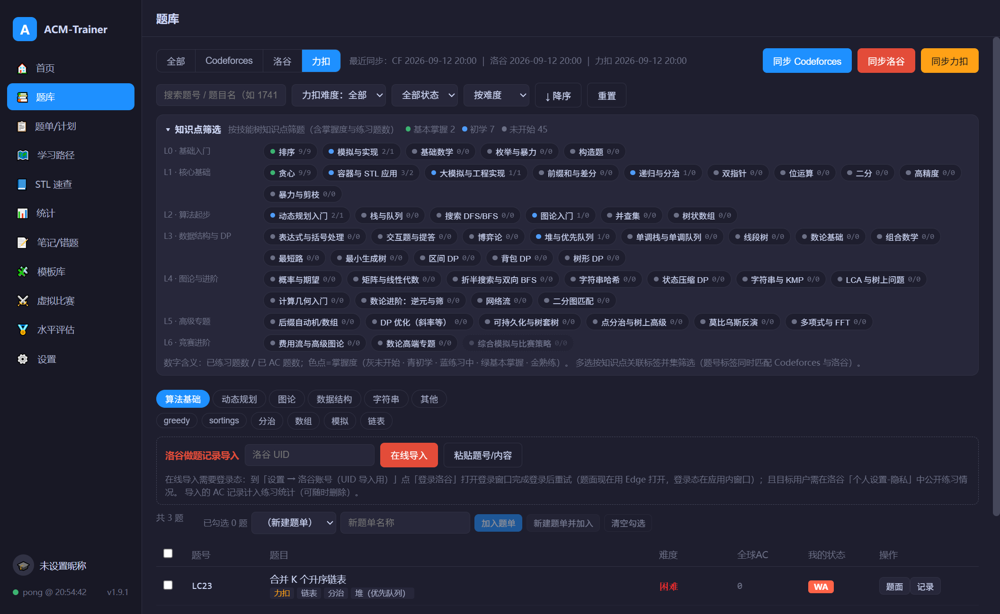

1. 题库页点 **「同步力扣」**：先拉全量列表（约 1.5 MB），再分 40 页拉取中文标题与中文标签（每页 100 题，页间限速 200ms），全程约 30–40 秒；
2. 切到 **「力扣」** 数据源：题号形如 `LC1`、`LCLCR001`，题目名为**中文标题**（`LC1` = 两数之和），行内显示「力扣」来源标签与**中文难度**（简单/中等/困难）；
3. 难度下拉为 **简单 / 中等 / 困难**（不是 rating 区间）；关键字可直接输入题名 slug，如 `two-sum`；
4. 三档题量：简单 889 / 中等 2076 / 困难 965；
5. 点「题面」由 **Edge 浏览器**打开 `https://leetcode.cn/problems/<slug>/`（与 CF/洛谷一致）；
6. 力扣题同样支持**记录练习、错题标记、笔记关联、知识点筛选与统计**；
7. **会员题**（约 534 道）也一并入库、不单独标记，只是题面需要登录力扣才能看——这是力扣站点的限制，不是应用问题。

> 说明：应用只支持 **leetcode.cn（力扣中文站）**；`leetcode.com` 在本机网络不可达，故未实现。

---

## 4. 题库：筛选与知识点筛选

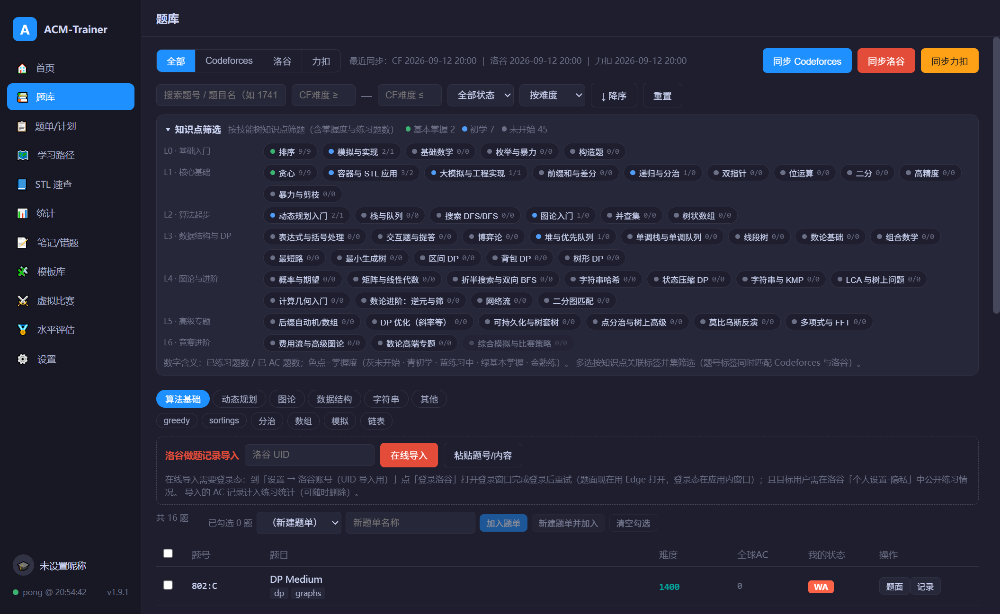

### 4.1 常规筛选

- **数据源**：全部 / Codeforces / 洛谷 / **力扣**（切换后可用筛选项自动适配）
- **难度**：CF 按难度分区间，洛谷按 0–7 评级，力扣按 简单/中等/困难
- **标签**：横向大类 Tab（算法基础/动态规划/图论/数学/数据结构/字符串/搜索/其他），组内多选
- **状态**：全部 / 未练习 / 已练习 / 已 AC
- **关键字**：题号、题名（力扣也支持题名 slug，如 `two-sum`）
- 排序：**按难度 / 按题号 / 按 AC 数**（见下方「排序说明」）；右上「重置」清空条件并恢复默认排序

### 4.1.1 排序说明（v1.9.1 修订）

「排序」下拉与右侧的 **「↑ 升序 / ↓ 降序」** 按钮配合使用：

- **按难度** = 用**各题源自己的难度**排列（不是同一个刻度）：
  - Codeforces → `rating`（800–3500，区间）；洛谷 → 难度 **0–7**；力扣 → **简单 / 中等 / 困难**；
  - 未标难度（CF 无 rating）/ 未定级（洛谷、力扣无难度）的题**恒排在列表最后**，切升序降序都不会跑到最前；
- **按题号** = **数字序**，不是字符串序：洛谷 `P1001 → P3374 → P10000`（`P10000` 不会排在 `P1001` 前面）；
  力扣数字题号在前（`LC1 → LC23 → LC146`），`LCR 001` / `面试题 xx` 这类**非数字题号排在数字题号之后**；
- **按 AC 数** = 全球通过数从多到少；
- **数据源选「全部」时先按题源分组**（Codeforces → 洛谷 → 力扣），再在组内按上面的口径排序 —— 三个题源的难度刻度不同，不做横向比较；
- **默认方向**：选「按题号」自动切**升序**；选「按难度 / 按 AC 数」自动切**降序**（省去手动切换）；
- 切换数据源时应用会**清空难度筛选**（洛谷 0–7 与力扣 1–3 刻度不同），避免「切过去变成空列表」。

### 4.2 知识点筛选（按技能树知识点练题）

点击题库页顶部 **「▸ 知识点筛选」** 展开：

- 按 **L0–L6 七层**（由易到难）分组列出全部 **54 个知识点标签**（v1.10 起；v1.6–v1.9.1 历史口径 44 个）
- 每个标签显示：
  - **掌握度色点**：灰=未开始 · 蓝=初学 · 紫=练习中 · 绿=基本掌握 · 金=熟练
  - **已练习题数 / 已 AC 题数**（如 `贪心 9/9`）
- 折叠头上还有一行**整体掌握概览**（如 `●熟练 3 ●基本掌握 5 ●练习中 8 ●初学 6 ●未开始 22`）
- **多选 = 并集筛选**：命中任一所选知识点的关联标签即列出（可与其他筛选条件叠加）
- 悬浮标签可看到**题源提示**（「可筛出 Codeforces 与洛谷题」/「主要筛出洛谷题」）
- **无关联标签的综合节点**（L6「综合模拟与比赛策略」）显示为禁用态，不参与筛题
- 「清空知识点」一键取消

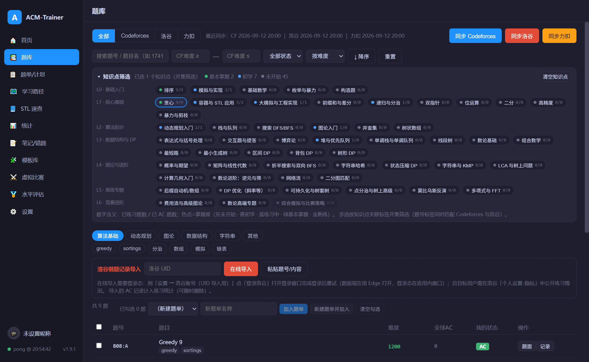

### 4.3 题号深链

地址栏（或在应用内跳转）支持 `#/problems?knowledge=dp,greedy` 形式，直接带入选中的知识点（多个用逗号分隔）；
**单个知识点**用 `#/problems?knowledge=dp` 即可，题库页会自动展开知识点面板并**只选中该节点**。
学习路径页的「去题库练习」与「去题库练习该知识点」按钮正是用这个方式跳转（见 §7）。

---

## 5. 题面：用 Edge 浏览器打开

- 题库列表每行的 **「题面」**、详情抽屉的 **「📖 打开题面（Edge）」**、虚拟比赛页的题面按钮，都会**用 Edge 浏览器打开**该题页面（Codeforces / 洛谷）。
- 应用会依次探测 Edge 安装位置（Program Files (x86) / Program Files / 本地 AppData，必要时查注册表），命中即用 `msedge.exe` 打开；**未检测到 Edge 时回退系统默认浏览器**，并提示实际使用的方式。
- 打开后可在浏览器里完成提交，回到应用用 §6 记录练习结果（应用不做站内判题，见 FAQ）。

> 说明：v1.8 起应用内**不再内嵌或弹窗展示题面**，避免网页进程带来的稳定性问题。

---

## 6. 记录练习

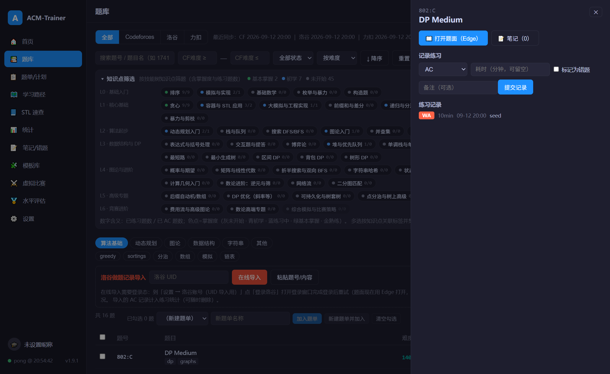

在题库列表点某行的 **「记录」**（或点题目名打开详情抽屉）→ 右侧抽屉中：

1. **结果**：AC / WA / TLE / RE / MLE / CE / SKIP / UNSOLVED
2. **耗时（分钟）**：**可留空**（留空或 0 表示未记录耗时）
3. **标记为错题**：勾选后进入错题本
4. **备注**：可选，回车即可提交
5. 点 **「提交记录」** → 提示「已记录 AC」；列表「我的状态」列与统计即时更新

抽屉内还会显示该题的**历史练习记录**、关联笔记数量，以及「📝 笔记」直达入口。

> 记录后若已展开「知识点筛选」，相关知识点的**掌握度与题数会立即刷新**。

---

## 7. 学习路径（技能树）

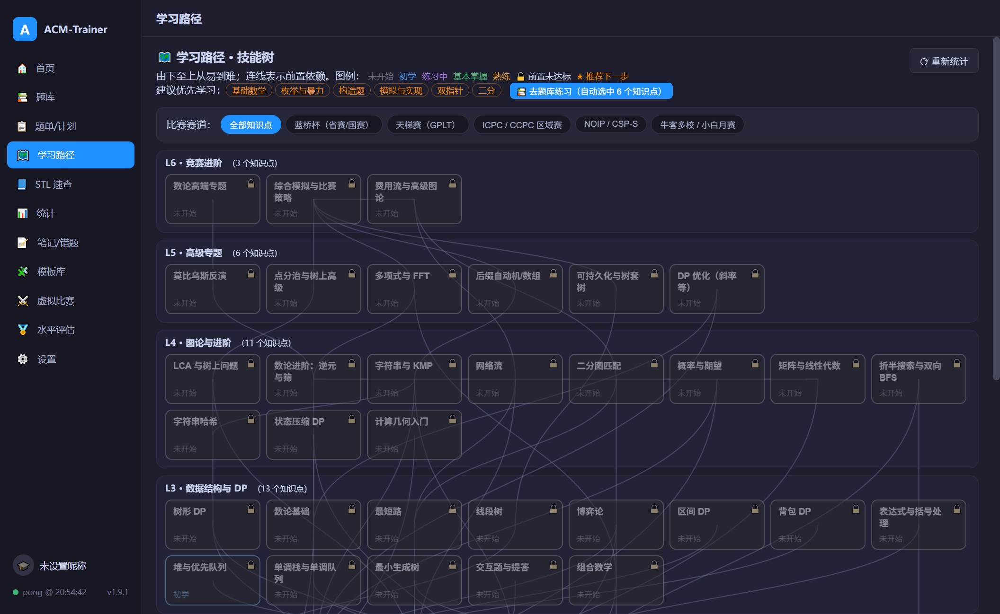

- 树**自下而上**由易到难：L0 基础入门 → L6 竞赛进阶，共 **54 个知识点**（v1.10 由 44 扩至 54，新增国内比赛高频考点）
- 节点之间的**连线表示前置依赖**；鼠标悬停某节点时只点亮与它直连的线，其余压暗
- 节点颜色即掌握度（五档配色），🔒 表示前置未达标，★ 表示「推荐下一步」
- 顶部图例说明各档颜色与标记

### 节点资料卡

点任意节点，右侧显示资料卡：

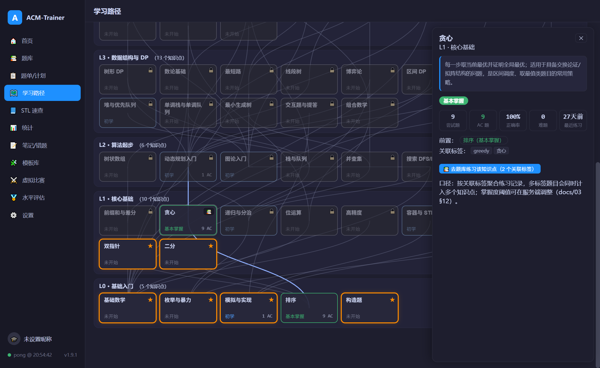

- 内置**知识点简介**（该知识点是什么、解决什么问题、典型方向）
- 掌握度徽标、构成统计（尝试题数 / AC 题数 / 正确率 / 难题数 / 最近练习）
- 前置状态（已满足 / 未达标）、关联题库标签
- **不再展示推荐题单**：想练题请用下方的「📚 去题库练习该知识点」按钮或卡片上的「📚」快捷按钮（见下一节）

### 建议优先学习 → 一键去题库练习

在「建议优先学习：…」一行末尾有按钮 **「📚 去题库练习（自动选中 N 个知识点）」**：

- 点击后跳转到题库页，**自动展开知识点筛选并选中这些建议学习的知识点**（按并集筛题）
- 地址栏会带上 `?knowledge=…`，刷新或返回后再进也保留选择

### 单个知识点 → 去题库练习（v1.9.1）

只想集中练**某一个**知识点时，有两个入口（效果相同：只选中该节点，按它的关联标签并集筛题）：

| 入口 | 位置 | 用法 |
| ---- | ---- | ---- |
| 详情面板按钮 | 点节点后右侧资料卡底部 | **「📚 去题库练习该知识点（N 个关联标签）」** —— 括号里是该节点的关联标签数量 |
| 卡片快捷按钮 | 每个知识点卡片**右上角** | 鼠标悬停（或键盘 Tab 聚焦）出现 **「📚」**，**不用打开资料卡**即可一键直达 |

- 跳转后题库页会**自动展开「知识点筛选」并只选中该知识点**（不会保留上一次的选择），列表按该节点关联标签并集筛题；
- 地址栏为 `#/problems?knowledge=<节点id>`，**刷新或返回后再进仍保留**（深链）；
- **综合节点不能用**：L6「综合模拟与比赛策略」等**没有关联标签**的节点，资料卡里该按钮为**置灰禁用**（悬停有说明），卡片上的「📚」点击只弹出提示、不跳转 —— 因为按它没有可直接筛选的标签，跳过去只会是空列表。

### 掌握度口径

- 按知识点**关联标签**聚合练习记录（多标签题会同时计入多个知识点）
- 五档阈值：无记录=未开始；仅少量/WA=初学；少量 AC=练习中；达标=基本掌握；更高门槛=熟练
- 缩窗口/改记录后点 **「⟳ 重新统计」** 可立即刷新

### 国内比赛赛道（v1.10，FR-26）

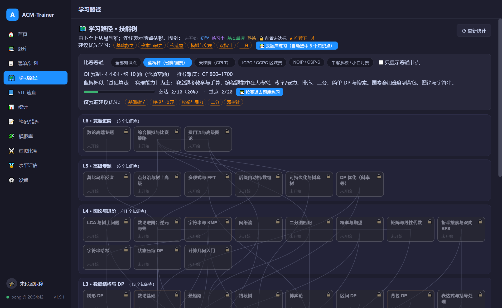

同一棵 54 节点技能树，按**不同比赛的考纲**组织成 5 个赛道；顶部切换条选赛道（含默认的「全部知识点」）：

| 赛道 | 赛制 | 推荐难度 |
| ---- | ---- | ---- |
| 蓝桥杯（省赛/国赛） | OI 赛制 · 4 小时 · 约 10 题（含填空题） | CF 800–1700 |
| 天梯赛（GPLT） | 3 小时 · 团体计分（基础/进阶/登顶三档） | CF 800–1900 |
| ICPC / CCPC 区域赛 | 5 小时 · ACM 赛制（20 分钟罚时）· 10~13 题 | CF 1200–2400 |
| NOIP / CSP-S | OI 赛制 · 3.5~4 小时 · 4 题 | CF 1000–2200 |
| 牛客多校 / 小白月赛 | 2~3 小时 · ACM 赛制 · 思维/构造占比高 | CF 800–2000 |

选中赛道后可以看到 / 操作：

- **赛制说明与推荐难度**：这个比赛考什么、时长题量、建议从哪个难度区间开始练；
- **必达进度条**：`必达 x/y（n%）· 重点 x/y` —— 「必达」是该赛道**必须拿下的节点**，达标线为**「基本掌握」及以上**（初学/练习中不算达标）；「重点」是建议重点投入的节点（含必达）；
- **该赛道建议优先**：列出**依赖已满足且尚未达标**的重点节点（最多 8 个，按层级由低到高），照着补最快；
- **📚 按赛道去题库练习**：把该赛道**重点节点**的关联标签并集带入题库知识点筛选，一键开练；
- **「只显示赛道节点」开关**：打开后隐藏与该赛道无关的节点，画面更聚焦；
- **节点卡片视觉区分**：**必达 = 双线框**、**重点 = 内阴影**、**非赛道 = 压暗** —— 扫一眼就知道哪些是「这个比赛必须会的」。

> 赛道只是**练习起点的建议**（按国内比赛常见考点分布整理），不是官方考纲；随时可以切回「全部知识点」看完整图谱。

---

## 8. 统计

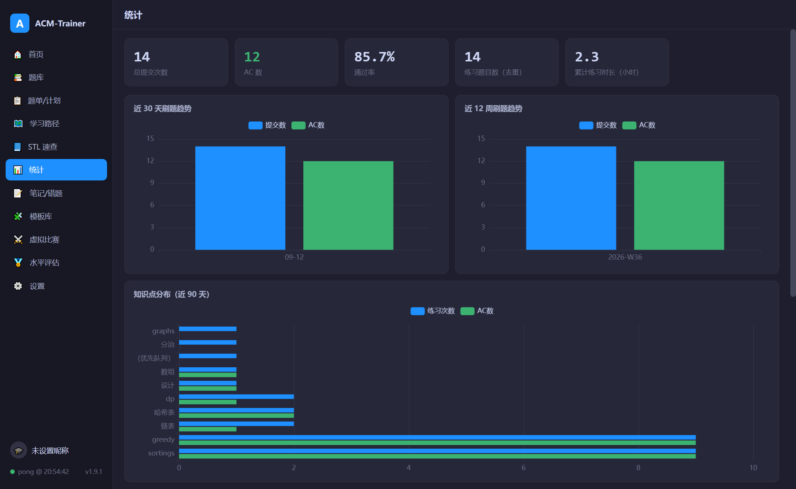

- 总览卡片：总提交次数、AC 数、通过率、去重题目数、累计练习时长
- 图表：练习趋势（日/周）、知识点分布等
- 数据来源为练习记录与虚拟比赛结果；记录后即时反映

### 8.1 难度分布（按题源）

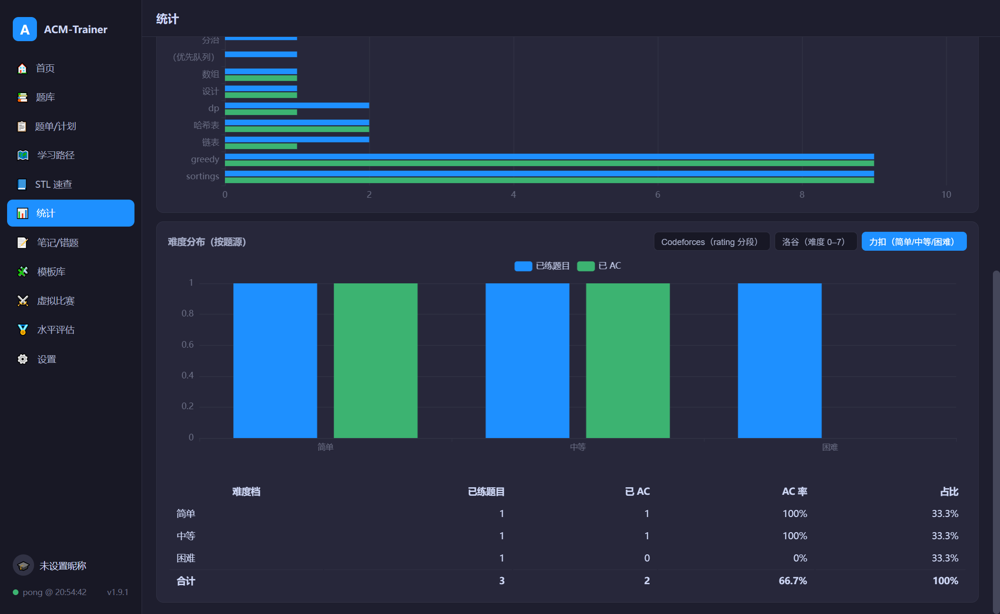

统计页下方的「**难度分布（按题源）**」板块，按题目难度看练习结构：

- **题源切换**：`Codeforces（rating 分段）` / `洛谷（难度 0–7）` / `力扣（简单/中等/困难）`——进入页面时会**自动定位到已练题数最多的题源**；
- **图表**：柱状图同时给出「已练题目」与「已 AC」两个系列；
- **表格**：难度档 / 已练题目 / 已 AC / AC 率 / 占比（占该题源已练题数百分比），末行是**合计**；某项为 0 的行会置灰；
- **分档口径**：
  - Codeforces：rating 每 200 一档（`<800`、`800–999` … `3000+`），没有 rating 的题单列「未标难度」；
  - 洛谷：难度 `0 · 暂无评定` … `7 · NOI/NOI+/CTSC`（**8 档始终展示**）；
  - 力扣：简单 / 中等 / 困难（**3 档始终展示**）；
  - CF 只显示「有数据的最小档 ~ 最大档」之间的档位（中间空档保留，不会堆出十几根空柱子）；
- 某个题源还没有练习记录时，会显示空态提示而不是空图表。

> 想找「哪个难度段最薄弱」时，对比该档的 **AC 率**与**占比**最直观：占比高但 AC 率低的档，通常是下一步要补的区间。

---

## 8.5 STL 速查（参考资料）

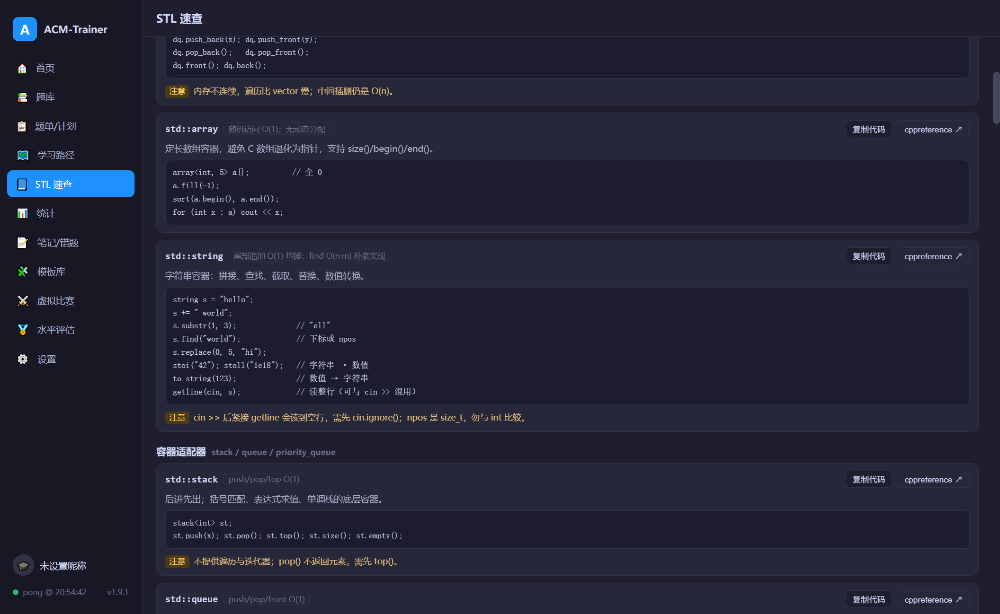

侧边栏 **「📘 STL 速查」**（v1.10 起为**第 5 项**、共 11 项；v1.8.2–v1.9.1 历史口径第 10 项）是内置的竞赛 STL 参考资料，**离线可用**：

- **内容**：34 条 / 6 大类 —— 序列容器、容器适配器、关联容器、其他常用（pair/tuple/bitset/数值）、算法库、技巧与坑（迭代器失效、比较器、快速 I/O、离散化、pbds 平衡树、bitset 优化 DP、multiset 正确删除、图存储、常用小函数等）
- **每条包含**：一句话用途、可复制的**代码片段**、**复杂度**标注、⚠️ **常见坑**、cppreference 官方文档链接（点按调用系统浏览器打开）
- **检索**：顶部搜索框支持关键字（匹配名称 / 用途 / 代码 / 坑点，多关键字为 AND），分类标签可只看某一类，点「重置」恢复全部
- **复制**：每条右上「复制代码」一键写入剪贴板，直接粘到编辑器使用

> 同源文档：`docs/10-STL参考.md`（由 `npm run docs:stl` 从同一份数据生成，适合离线阅读/打印）。
> 若你想把它当模板长期使用，可复制到「模板库」并按分类保存。


## 9. 笔记与错题本

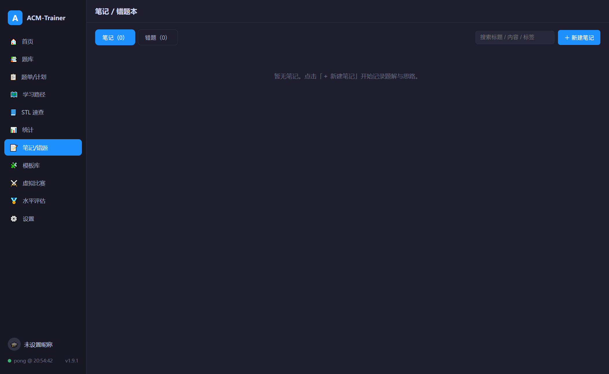

- **两个 Tab**：笔记 / 错题
- 笔记支持 Markdown（代码高亮）、标签、关联题目；左侧列表可搜索
- 点「＋ 新建笔记」进入编辑器：

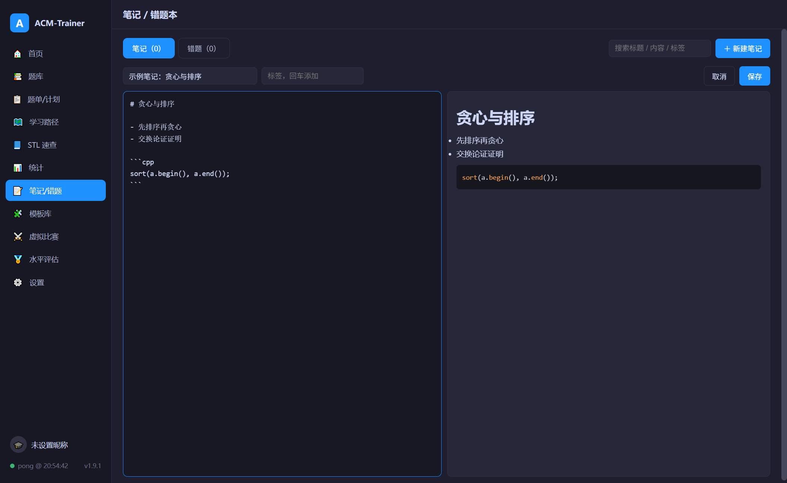

- 左侧编辑、右侧实时预览
- **自动保存**：停止输入（默认 2 秒）后自动落库 —— **新建的笔记在首次自动保存时即创建**，无需手动保存；编辑中点「取消」会回收这次自动创建的笔记
- 自动保存间隔可在「设置 → 偏好设置」调整（500–600000 毫秒）
- **Tab 缩进**：编辑器内按 Tab 缩进，支持多行整体缩进；缩进宽度可选 Tab / 2 / 4 / 8 空格
- 错题 Tab：列出勾选过「错题」的记录，可「取消标记」或「删除」

---

## 10. 模板库

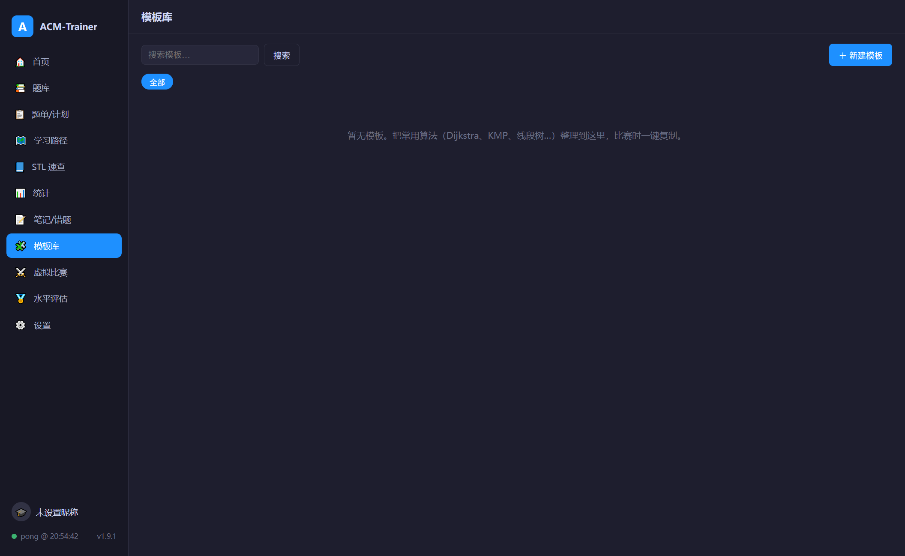

- 按分类（图论 / DP / 数论…）管理算法模板
- 字段：分类、标题、语言、描述、代码；支持搜索
- **一键复制**代码到剪贴板；代码区支持 Tab 缩进与语法高亮

---

## 11. 虚拟比赛

### 11.1 创建

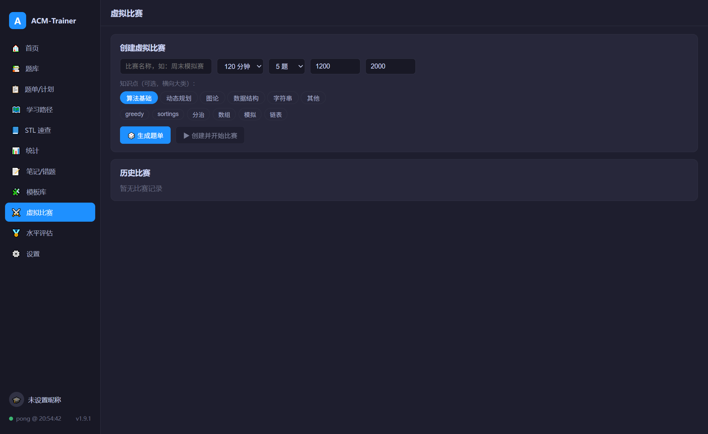

1. 填比赛名称、比赛时长（下拉：60/90/120/180 分钟）
2. 选题数（3/5/7/10）
3. 设定**难度区间**（难度 ≥ / 难度 ≤，默认 1200–2000）
4. 可选知识点偏好的标签
5. 点 **「🎲 生成题单」** → 下方列出候选题（同卷不重复、难度尽量均匀）

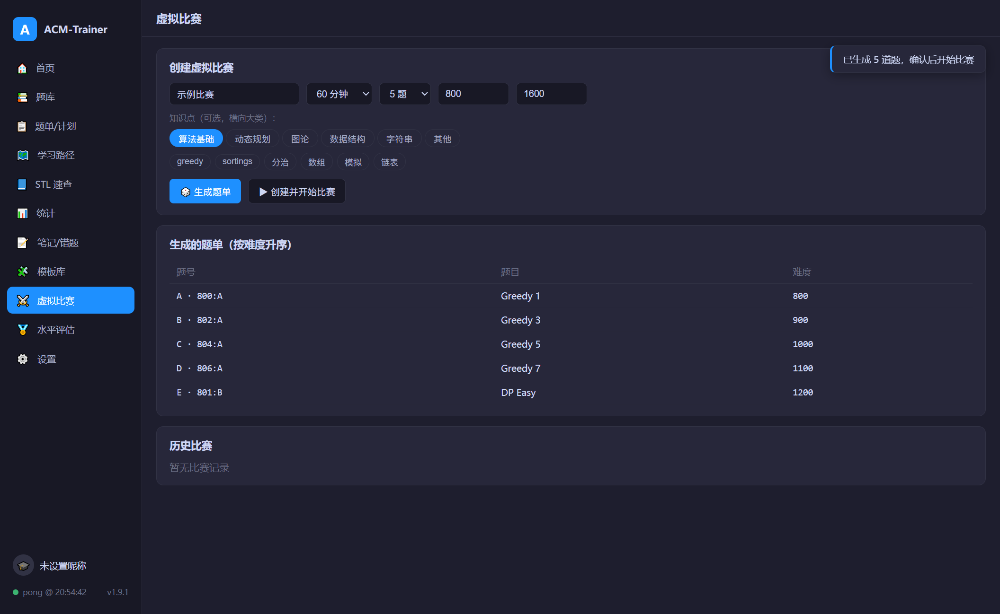

6. 点 **「▶ 创建并开始比赛」** 进入比赛

### 11.2 进行中

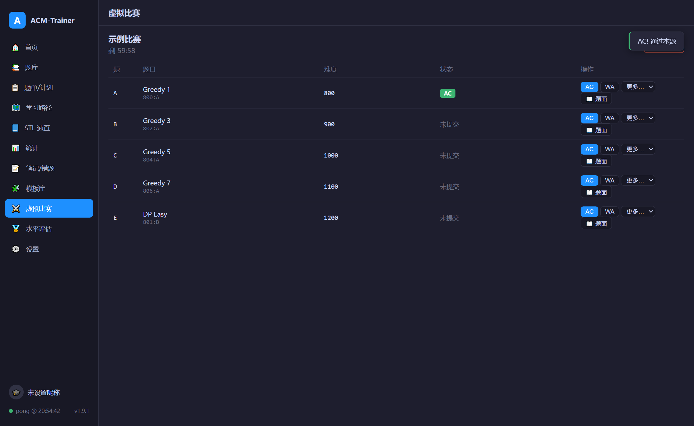

- 顶部倒计时；每题带 ACS/WA 等状态徽章
- 每题可点 **AC / WA**，或用下拉选择 TLE、RE、MLE、CE 等
- 「📖 题面」用 Edge 打开该题页面
- 中途可「结束比赛」，也可离开页面后再「继续」

### 11.3 结果

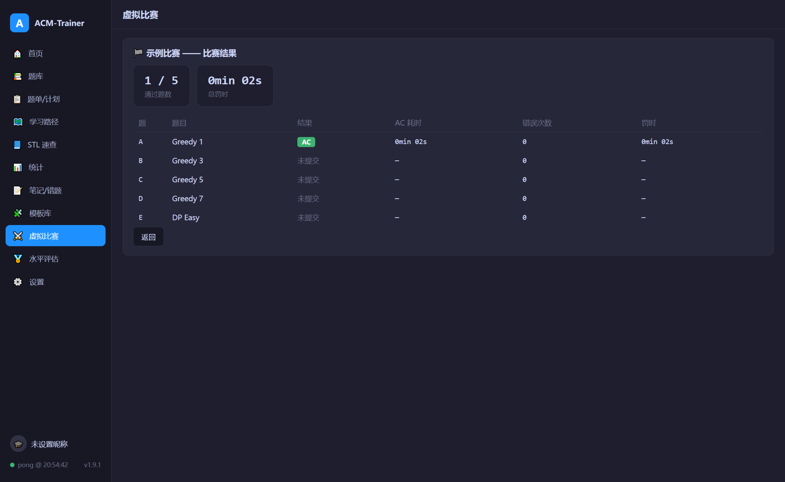

- 通过题数、**总罚时**（ACM 规则：每题 AC 耗时 + 错误提交数 × 20 分钟）
- 逐题结果表：判定、AC 耗时、错误次数、该题罚时
- 成绩计入「水平评估」的比赛分

---

## 12. 水平评估

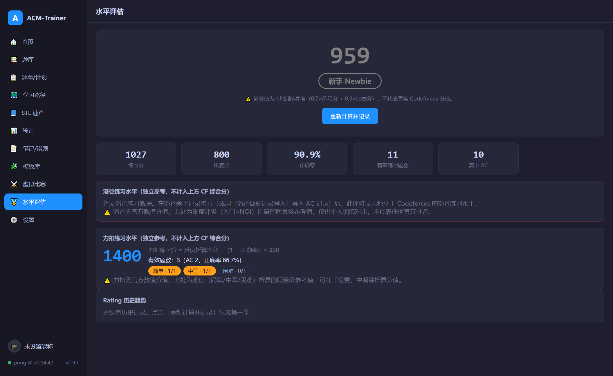

- **综合分** = w₁ × CF 练习分 + w₂ × 比赛分（默认 0.7 / 0.3，权重可在设置里改）
  - 练习分 = `clamp(平均难度分 − (1 − 正确率) × 300)`
  - 比赛分 = `clamp(AC 平均分 − 总罚时(分钟) × 2)`
- 展示称号与颜色、分解项（练习分/比赛分/有效题数/正确率）
- **洛谷练习水平**独立计算并单独展示（洛谷难度 1–7 映射为近似分值，默认 900–2300 可改），**不并入**综合分
- **力扣练习水平**（v1.9）同样独立计算并单独展示（见 12.1），**不并入**综合分
- 「重新计算并记录」把当前分值写入历史，趋势图展示变化
- 页面含免责说明：分值为**本地训练参考**，不代表真实 Codeforces 分值

### 12.1 力扣练习水平

和洛谷板块一样，力扣题也有一块「**力扣练习水平**」（在「洛谷练习水平」附近，均**不并入**上方 CF 综合分）：

- **分值** = `难度折算均分 −（1 − 正确率）× 300`，下限 800、上限 3500；
- **默认折算**：简单 1000 / 中等 1500 / 困难 2000（可在设置里改，见 13.1）；
- **样本**：近 90 天的力扣练习记录，**每题取最近一次**结果（AC 记为通过）；
- **展示**：分值、有效题数（AC 数、正确率）、各难度分布 chips（如 `简单 · 1/1`）与免责说明；
- 改完难度映射后，点「重新计算并记录」才会生效。

---

## 13. 设置


| 面板 | 内容 |
| ---- | ---- |
| 偏好设置 | 同步提醒开关、默认比赛时长、编辑器 Tab 缩进宽度、笔记自动保存间隔 |
| 个人资料 | 昵称与头像（本地图片，显示在侧边栏与首页问候） |
| 水平评估权值 | 两个权重输入（互补联动，和恒为 1），可恢复默认 0.7 / 0.3 |
| 洛谷难度映射 | 难度 1–7 → 分值（默认 900–2300），可恢复默认 |
| 力扣难度映射 | 简单/中等/困难 → 分值（默认 1000 / 1500 / 2000），可恢复默认（v1.9） |
| 洛谷账号（UID 导入用） | 「登录洛谷」按钮（仅用于 UID 在线导入的登录态）＋ 题面由 Edge 打开的说明 |
| 数据备份 | 导出 / 导入 JSON 备份 |

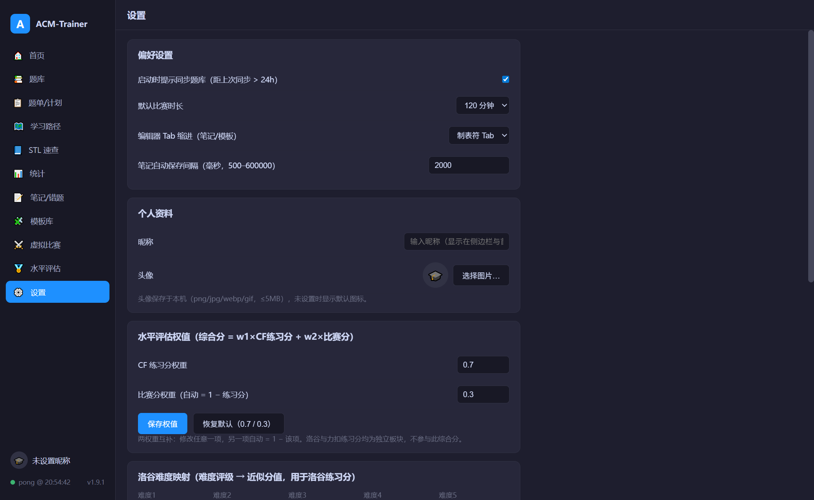

### 13.1 力扣难度映射

力扣没有官方数值分值，应用用「难度 → 近似分值」折算参加练习分计算：

| 难度 | 默认折算分值 | 可调范围 |
| ---- | ---- | ---- |
| 简单（难度 1） | 1000 | 800–3500 的整数 |
| 中等（难度 2） | 1500 | 同上 |
| 困难（难度 3） | 2000 | 同上 |

- 面板位置：设置页「**力扣难度映射**」；
- 修改后需要回「水平评估」点 **「重新计算并记录」** 才生效；
- 输入非法值（超出范围、非数字、留空）会被**丢弃**；三项全非法时**回退默认** 1000 / 1500 / 2000；
- 点「恢复默认（1000 / 1500 / 2000）」一键还原；
- 该映射只影响力扣练习水平，**不影响** CF 综合分与洛谷练习分。

---

## 14. 洛谷 UID 做题记录导入

题库页「洛谷做题记录导入」区域提供两条通道：

1. **粘贴导入（推荐，无需登录）**：在浏览器打开 `https://www.luogu.com.cn/user/你的UID?_contentOnly=1`，全选复制页面内容（或任意含 P 题号的文本：题号列表、主页文字、网页源码均可）→ 粘贴到文本框 → 「粘贴导入」。应用会**直接从文本识别 P 题号**并写入 AC 记录。
2. **在线导入（需登录态）**：先在 **设置 → 洛谷账号（UID 导入用） → 登录洛谷** 打开登录窗口完成登录（账号密码或扫码），回到题库页输入 UID → 「在线导入」。若提示需要登录或未公开练习情况，请改用粘贴通道。

导入的 AC 记录会写入练习记录（备注标明来源 UID），计入统计与技能树掌握度；同一题重复导入会自动跳过。

---

## 15. 数据备份与迁移

- **导出**：设置 → 数据备份 → 「⬇ 导出备份」→ 生成 JSON（含题库、练习记录、笔记、模板、比赛、评估历史、设置，以及 **v1.10 新增的 5 张表：题单 / 题单条目 / 训练计划 / 计划任务 / 计划没空日**）
- **导入**：点「⬆ 导入备份」，**会覆盖当前全部本地数据**，确认后执行
- 往返已自动化验证（`npm run verify:smoke` 场景 5）：导出 → 变更数据 → 导入后，备份内的数据完整还原、导出后的变更被覆盖、统计数据与导出时逐项一致
- **题单 / 复习进度 / 训练计划随备份一起迁移**（v1.10）：换机或重装后导入备份，题单条目、复习档位与到期日、计划排期与没空日都会原样恢复
- 建议：大版本升级前、或大量录入笔记后导出一次
- 直接复制数据库文件亦可：`%APPDATA%\acm-trainer\acm-trainer.db`

---

## 16. 常见问题（FAQ）

**Q1：题库同步失败/超时？**
检查网络与代理；应用会自动重试一次，失败不影响已缓存数据。洛谷同步页数多（约 326 页），请预留 3–5 分钟。

**Q2：点「题面」没有用 Edge 打开？**
说明本机未在常见位置检测到 Edge（应用会回退到系统默认浏览器，并给出提示）。若希望强制用 Edge，请确认 `msedge.exe` 存在（通常在 `C:\Program Files (x86)\Microsoft\Edge\Application\`）。

**Q3：应用内能直接判题吗？**
v1.8 起**不提供**站内判题（v2.0 的本地判题方案已按需求回退）。请在 Edge 打开的原站页面提交，然后用 §6 记录结果。

**Q4：知识点筛选点了却没题？**
部分知识点的标签只在洛谷侧（如「树状数组」「斜率优化」），若只同步了 Codeforces 就会出现 0 结果；悬浮标签可看到题源提示。L6「综合模拟与比赛策略」无关联标签，已置为禁用。

**Q5：掌握度与我的实际水平不符？**
掌握度按**题目标签**聚合练习记录，多标签题会同时计入多个知识点；另外只有**记录下来的练习**才参与统计（在洛谷/CF 网站做题但没有在本应用记录，不会计入）。可用「重新统计」立即刷新。

**Q6：启动失败怎么办？**
查看 `%APPDATA%\acm-trainer\crash.log`；常见原因是原生模块与 Electron 版本不匹配（安装包已锁定匹配版本，源码运行请勿单独降级 Electron）。

**Q7：笔记会不会丢？**
已实现的自动保存对新建与已有笔记均生效（默认 2 秒）；但仍建议重要题解随手按「保存」并在设置里定期导出备份。

**Q8：水平评估页打开是空白？**
v1.8.4 已修复：早期版本里历史快照的时间字段未正确取出，点过「重新计算并记录」（或自动记录）产生第一条历史后，页面渲染会失败而只剩空白。升级到 v1.8.4 后进入该页即正常显示；已记录的历史数据不受影响，无需重建。

**Q8：数据会联网上传吗？**
不会。除同步题库、抓取题面（浏览器打开）、洛谷导入外，应用不向任何服务器上传数据，全部保存在本机。

**Q9：力扣同步很慢吗？要多久？**
约 **30–40 秒**：先一次拉全量列表（约 1.5 MB），再分 **40 页**取中文标题与中文标签（每页 100 题，页间限速 200ms）。这是为礼貌抓取刻意加的间隔；中途失败可重新同步（幂等），已入库数据不受影响。

**Q10：为什么库里有力扣「会员题」？**
力扣算法题全集共 3930 道，其中约 **534 道为会员题**。应用把全集一并入库（不单独标记），这样题量统计与知识点筛选才完整；只是这些题的题面需要登录力扣才能打开，属站点限制。

**Q11：力扣练习分怎么算？**
与洛谷练习分同一公式：`难度折算均分 −（1 − 正确率）× 300`（限 800–3500），取近 90 天记录、每题算最近一次。默认折算 **简单 1000 / 中等 1500 / 困难 2000**，可在「设置 → 力扣难度映射」修改，改完点「重新计算并记录」生效；该分值**不并入** CF 综合分。

**Q12：为什么洛谷视图里「按难度」排序没反应？**
**v1.9.1 已修复**。v1.9.0 及更早版本里，三个题源共用同一个排序表达式（都按 CF 的 `rating`），而洛谷/力扣题的 `rating` 恒为空 —— 它们的难度存在各自题源的难度列里，所以这两个视图里点「按难度」看起来毫无变化（同理「按题号」在洛谷视图里是字符串序，`P10000` 会排在 `P1001` 前面）。
现在的正确用法：切到洛谷/力扣视图后选「**按难度**」即可按该题源自己的难度排列（洛谷 0–7、力扣 简单/中等/困难），选「按题号」按**数字序**；未标难度/未定级的题**始终排在最后**；数据源选「全部」时会先按题源分组（Codeforces → 洛谷 → 力扣）再组内排序。详见 §4.1.1。

**Q13：题单和题库是什么关系？**
**题库是「所有题的字典」，题单是「你要练的这批题」。** 题库（Codeforces / 洛谷 / 力扣三源）是只读的题目索引，你不去改它；题单是从题库里挑出来的一份练习清单（同一道题可以在多份题单里各出现一次），每条记录**完成状态、备注、复习档位与到期日**。题单不会复制题目数据，只引用题库里的题号；所以**先同步题库，题单的三种建法（勾选 / 粘贴识别 / 按知识点生成）才能匹配到题**。删除题单只删清单，不动题库与练习记录。详见 §18。

**Q14：题单里的复习间隔怎么算？**
勾选完成即进入复习，阶梯固定为 **1 / 3 / 7 / 14 / 30 / 60 天**（共 6 档，封顶 60 天）。之后在「今日复习」里给反馈：点「**一般**」按下一档间隔重来（1→3→7→…），点「**困难**」退回上一档（最低仍是 1 天），点「**轻松**」直接跳一档（+2，最多到第 6 档）。到期日 `≤ 今天` 的条目都会出现在「今日复习」（**逾期也算**）；已进入复习的条目再勾选/取消勾选**不会清空复习排期**（只切换完成状态，做题成果不丢）。详见 §19。

**Q15：训练计划没排完怎么办？**
如果设了**目标日期**而题目比「可用天数 × 每日题量」多，超出的部分会全部计入 **overflow** 并在界面上**明确提示**（例如「有 N 题超出目标日期」）—— 应用**不会**把它们硬塞进最后一天，也**不会静默丢题**。三种解法：① 把目标日期往后放；② 调大「每日题量」；③ 取消目标日期（不限结束时间，按每日题量一路排下去）。另外「标记这天没空」后，其后未完成任务会自动顺延，**总题量不变、已完成的不动**。详见 §20。

---

## 17. 快捷键与小技巧

| 技巧 | 说明 |
| ---- | ---- |
| 记录后即时联动 | 提交练习后，知识点筛选区的色点与「已练/已 AC」立即更新 |
| 知识点并集筛选 | 多选知识点 = 命中任一即列出，便于「同时练贪心 + 二分」这类组合 |
| 深链 | `#/problems?knowledge=dp,greedy` 直接带筛选项进入题库（单个节点 `#/problems?knowledge=dp`） |
| 一键跳题库 | 学习路径「建议优先学习」→「去题库练习」自动选中这些知识点 |
| 单节点直达 | 知识点卡片右上角悬停出现「📚」→ 不打开资料卡就把该知识点带入题库（其关联标签并集筛题） |
| 排序默认方向 | 选「按题号」自动升序、选「按难度 / 按 AC 数」自动降序；空难度/未定级题恒排最后 |
| 编辑器缩进 | 笔记/模板编辑器按 Tab 缩进；多行选中后 Tab 整体缩进，Shift+Tab 反缩进 |
| 错题直达 | 题库抽屉里点「📝 笔记」跳到该题笔记；笔记 Tab 里可回看错题清单 |
| 力扣按标签刷题 | 数据源切「力扣」+ 知识点筛选（如「动态规划入门」）即可筛出成百上千道力扣题，配合难度下拉「中等」逐步进阶 |
| 三源难度体检 | 统计页「难度分布（按题源）」看各题源各档的已练/AC 率，找出「占比高但 AC 率低」的区间重点补 |
| 虚拟比赛重入 | 比赛中途离开页面，回到虚拟比赛页点「继续」可接着计时 |
| 题库→题单（v1.10，FR-27） | 题库页每行**首列复选框**（表头勾选 = 本页全选）→ 工具条「已勾选 N 题 → 加入题单」，批量把当前想练的题收进题单 |
| 赛道一键开练（v1.10，FR-26） | 学习路径选赛道（如「蓝桥杯」）→「📚 按赛道去题库练习」→ 该赛道重点节点的关联标签直接带进题库筛选 |
| 只显示赛道节点（v1.10，FR-26） | 学习路径打开「只显示赛道节点」，隐藏与当前比赛无关的节点，图谱更聚焦 |
| 粘贴题号建题单（v1.10，FR-27） | 题单页「📋 粘贴题号识别」：从聊天记录/题解里贴一段 `1741A P3374 LC146` 或题面链接即可成单，未命中的会列出来提醒你 |
| 复习反馈快捷键（v1.10，FR-29） | 「今日复习」每题三个按钮：**困难退一档 / 一般进一档 / 轻松跳一档** —— 按真实手感点，下次到期日自动算 |
| 计划没空日（v1.10，FR-28） | 训练计划日历上点「标记这天没空」并写原因 → 其后未完成任务自动顺延，总题量不变、已完成不动 |
| 免安装版 | `dist\win-unpacked\ACM-Trainer.exe` 可直接运行，不写注册表 |

---

## 18. 题单（v1.10，FR-27）

题单 = **一份「你要练的这批题」的清单**：从题库里挑题组成，记录每题**完成状态、备注、复习档位与下次复习日期**。
入口：侧边栏第 3 项 **「📋 题单/计划」**（路由 `/lists`），页面顶部有三个 Tab：**📋 题单 / 🔁 今日复习 / 🗓️ 训练计划**。

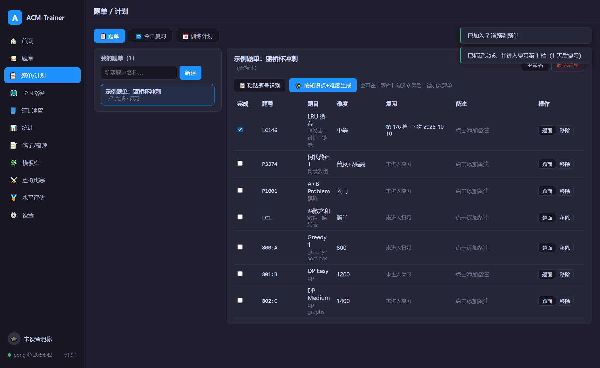

页面结构：

- **左侧题单列表**：每份题单显示 **`完成/总数`**、已进入复习的条数、**待复习数**（到期 ≤ 今天，逾期也算）与所属赛道；
- **右侧条目表格**：`完成`（复选框）/ `题号` / `题目` / `难度` / `复习`（档位与下次日期）/ `备注`（点击即可编辑）/ `题面` / `移除`；
- 顶部按钮：**「📋 粘贴题号识别」**、**「✨ 按知识点+难度生成」**；题单可**重命名 / 删除题单**。

### 18.1 建法一：从题库勾选加入

1. 到 **题库** 页，勾选想练的题（每行**首列复选框**；点表头复选框 = **勾选本页全部**）；
2. 底部工具条出现 **「已勾选 N 题」** → 点 **「加入题单」**；
3. 在弹窗里**选择已有题单**或**新建题单**（名称必填）→ 确认「加入题单」。

加入是**幂等**的：已经在题单里的题会被跳过并提示跳过数量，不会产生重复行。

### 18.2 建法二：粘贴题号文本识别

1. 题单页点 **「📋 粘贴题号识别」**；
2. 把题号或题面链接粘贴进文本框，例如：

   ```text
   1741A  CF 1741 A  P3374  洛谷 P1000  LC1  LC 146
   https://codeforces.com/problemset/problem/1741/A
   https://www.luogu.com.cn/problem/P3374
   https://leetcode.cn/problems/two-sum/
   ```

3. 点识别 → 应用会**自动去重**、与本地题库匹配（力扣链接按 slug 反查题号），显示 **「识别到 N 道题」**；
4. 确认加入题单。

**未命中的题号会回显列出**（最多 50 条）—— 通常是「本地题库还没同步该题源」或「题号写错」，不会静默丢掉。

### 18.3 建法三：按知识点 + 难度一键生成

题单页点 **「✨ 按知识点+难度生成」**，可选：

| 选项 | 说明 |
| ---- | ---- |
| 知识点 | 多选（并集筛题）；**可一键套用某个赛道的重点节点**，省去手工挑标签 |
| 题量 | 想生成多少道 |
| 数据源 | 全部 / Codeforces / 洛谷 / 力扣 |
| CF rating 区间 | 针对 Codeforces 题（如 1200–1600） |
| 洛谷 / 力扣难度区间 | 针对这两个题源各自的难度档 |
| 排除已练 | 勾上则跳过有练习记录的题 |

抽题采用**难度分层轮转**：把候选题按难度分桶后**逐轮各取一题**，所以整份题单会**跨难度层分布**，而不是一股脑挤在同一难度。

> 三种建法可以混用：例如先「生成」一份 20 题的骨架，再从题库勾选手动补几道，或粘贴题解里的题号补进来。

---

## 19. 题单内复习与「今日复习」（v1.10，FR-29）

间隔复习的目的：**做过的题按时间间隔回来重做，避免「做过就忘」**。

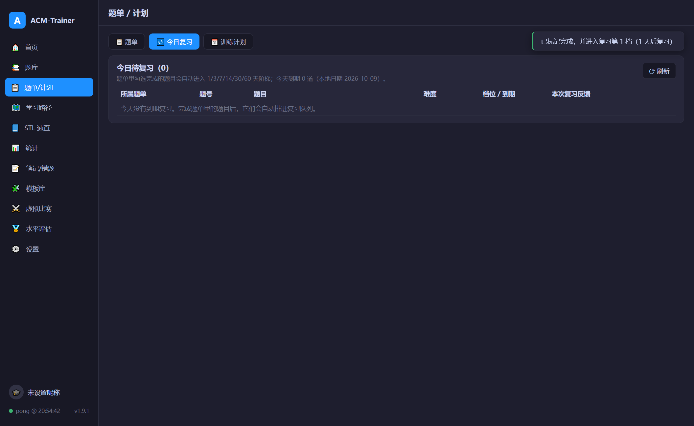

### 19.1 复习阶梯

| 档位 | 间隔 |
| ---- | ---- |
| 第 1 档 | 1 天 |
| 第 2 档 | 3 天 |
| 第 3 档 | 7 天 |
| 第 4 档 | 14 天 |
| 第 5 档 | 30 天 |
| 第 6 档 | 60 天（封顶） |

### 19.2 怎么用

1. 在题单里**勾选某题的「完成」** → 该题**自动进入第 1 档**，「复习」列显示 **`第 1/6 档 · 下次 <明天>`**；
2. 到期后（`下次日期 ≤ 今天`）切到 **「🔁 今日复习」Tab** —— 这是**跨所有题单的汇总**（**逾期也算到期**），
   每题显示所属题单、题号、题目、难度、当前档位与到期日，右侧四个按钮：**困难 / 一般 / 轻松 / 题面**；
3. 按真实手感点反馈，档位与下次日期立即更新：

   | 反馈 | 效果 | 举例 |
   | ---- | ---- | ---- |
   | **困难** | **退一档**（最低第 1 档） | 第 3 档 → 第 2 档（下次 3 天后） |
   | **一般** | **进一档** | 第 1 档 → 第 2 档（下次 3 天后） |
   | **轻松** | **跳一档**（+2，封顶第 6 档） | 第 1 档 → 第 3 档（下次 7 天后） |

4. 走完 6 档后显示 `第 6/6 档 · 已巩固`；暂无到期条目时该 Tab 显示**空态文案**。

### 19.3 两个不会踩的坑

- **重复勾选不清空复习排期**：已经在复习中的题再勾一次「完成」，档位与到期日**保持不变**；
- **取消勾选只清完成状态**：把「完成」取消掉，复习档位/到期日**仍然保留**（做题成果不丢），重新勾选即继续原进度。

---

## 20. 训练计划（v1.10，日历排期式，FR-28）

训练计划把「一堆题」排到**具体的日历日期**上：每天做几道、哪天休息、哪天没空，一目了然。

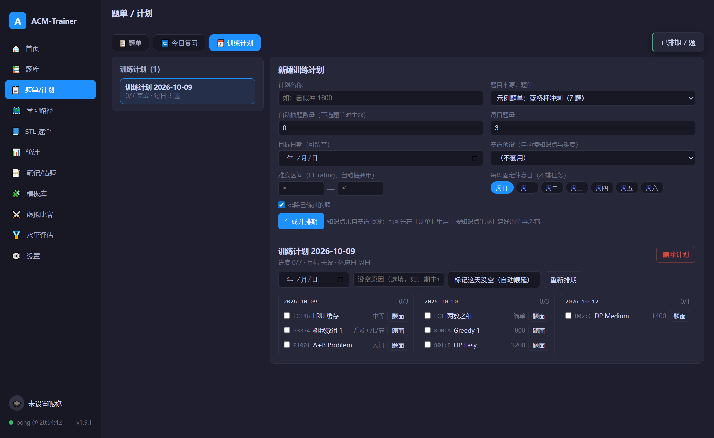

### 20.1 新建计划

在「🗓️ 训练计划」Tab 点新建，填：

| 字段 | 说明 |
| ---- | ---- |
| 名称 | 计划名（如「蓝桥杯冲刺」） |
| 题单 / 自动抽题 | 题目来源：选一份**题单**；或选「（不用题单，自动抽题）」并给**抽题数量**（按知识点+题量自动抽，可套用赛道预设） |
| 每日题量 | 每个可用日排几道（默认 3） |
| 目标日期 | 排到这一天为止；**留空 = 不限结束**（一直排到题排完） |
| 赛道预设 | 套用某个国内比赛赛道的推荐知识点与难度区间 |
| CF rating 区间 | 抽题的难度范围 |
| 每周休息日 | **多选**（如固定周日休息）—— 这些星期几不排题 |
| 排除已练 | 跳过已有练习记录的题 |

### 20.2 日历视图与打卡

- 计划生成后，右侧**日历按日期分组**列出任务；每个任务可**勾选打卡**（完成态即时渲染），也可点「题面」直接去原站做题；
- 计划列表显示 **`完成/总数`**。

### 20.3 没空日与顺延

真实生活里总有几天做不了题：

1. 在日历某天点 **「标记这天没空」** 并填原因（如「期中考试」）；
2. 该日期会显示**日期 + 原因**，并且**其后所有未完成任务自动顺延**（顺延后同样跳过休息日/没空日）；
3. **总题量不变，已完成的任务不动** —— 只是把没做完的部分整体往后推。

其他操作：**「重新排期」**（按当前参数重排；已完成的不动）、**删除计划**（连同其任务与没空日一起删除，**不影响题单本身**）。

### 20.4 「排不完」时会怎样

如果给了**目标日期**但题量大于「可用天数 × 每日题量」，超出的部分会全部计入 **overflow** 并在界面**明确提示**（如「有 N 题超出目标日期」）：

- 应用**不会**把它们硬塞进最后一天（那样最后一天会变成 20 题）；
- 也**不会静默丢题**（提示里会给出超出数量）；
- 想排完就三选一：**放宽目标日期** / **调大每日题量** / **清空目标日期**（不限结束时间）。

---

## 附：本手册配图的生成方式

配图由自动化脚本驱动**真实应用**截图，可随时重新生成（用于文档更新）：

```bat
npm run build          :: 确保 out/ 为最新构建
npm run docs:shots     :: 生成 docs/images/*.png（使用独立临时数据库，不影响你的数据）
```

相关自动化能力（见 `docs/03 §16`、`docs/04 §12/§13`）：

| 命令 | 作用 |
| ---- | ---- |
| `npm run verify:gui` | 特性验收（导航 **11** 项 / STL 速查 / 知识点筛选（**54** 标签）/ 配色 / 资料卡 / 水平评估 / 力扣数据源 / 力扣练习水平 / 难度分布 / 排序规则 / 单知识点跳题库 / **赛道（5 个国内比赛 + 54 节点 + 必达进度）/ 题单三 Tab / 粘贴识别与加入 / 勾选完成进入复习第 1 档 / 今日复习 / 训练计划日历·打卡·标记没空日** 等 **59 项**断言 + 截图，实测 **57/57 通过**；v1.9.1 历史口径 41 项，见 §12 与 docs/04 §12） |
| `npm run verify:smoke` | 端到端冒烟（记录练习联动/统计/虚拟比赛全流程/笔记自动保存/一键跳题库/**备份导出导入往返**等 **33 项**断言 + 截图） |
| `npm run verify:lc` | **真实力扣同步验收**（联网调用 leetcode.cn，约 30–40 秒，12 项断言：题数 > 3900、三档难度、标签覆盖、LC1 中文标题与 URL、界面与库一致等） |
| `npm run docs:shots` | 生成本手册配图（`docs/images/`，共 **24 张**；v1.10 新增 `05c-skill-track.png` / `05d-problem-lists.png` / `05e-review.png` / `05f-training-plan.png`） |
| `npm test` | 单元 / 集成 / 渲染组件测试（**375 例 / 39 文件**；v1.9.1 历史口径 314 例 / 33 文件。PowerShell 下用 `npm.cmd test`，或直接 `node node_modules/vitest/vitest.mjs run`） |
